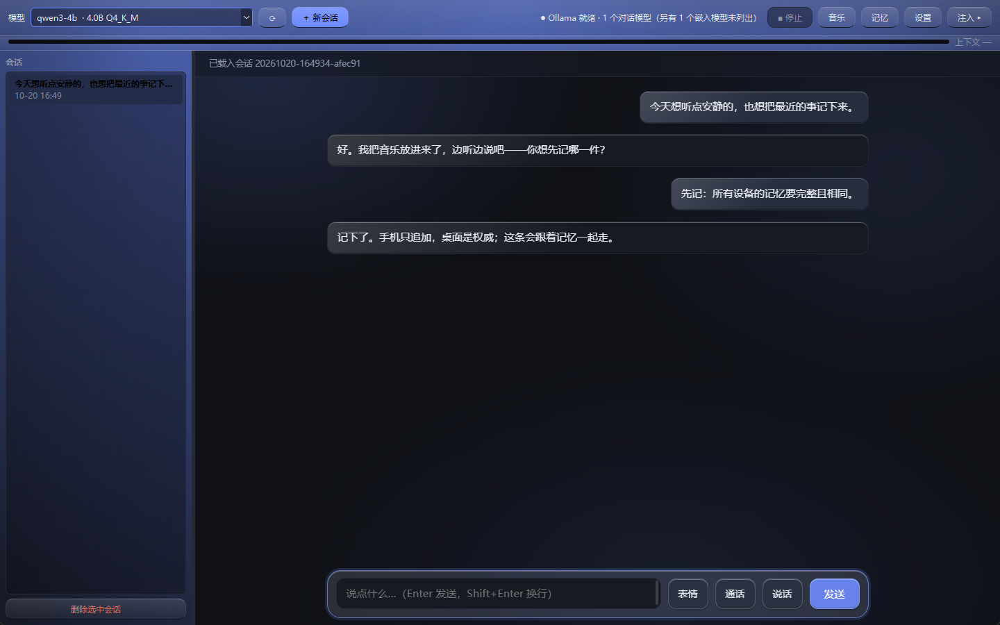
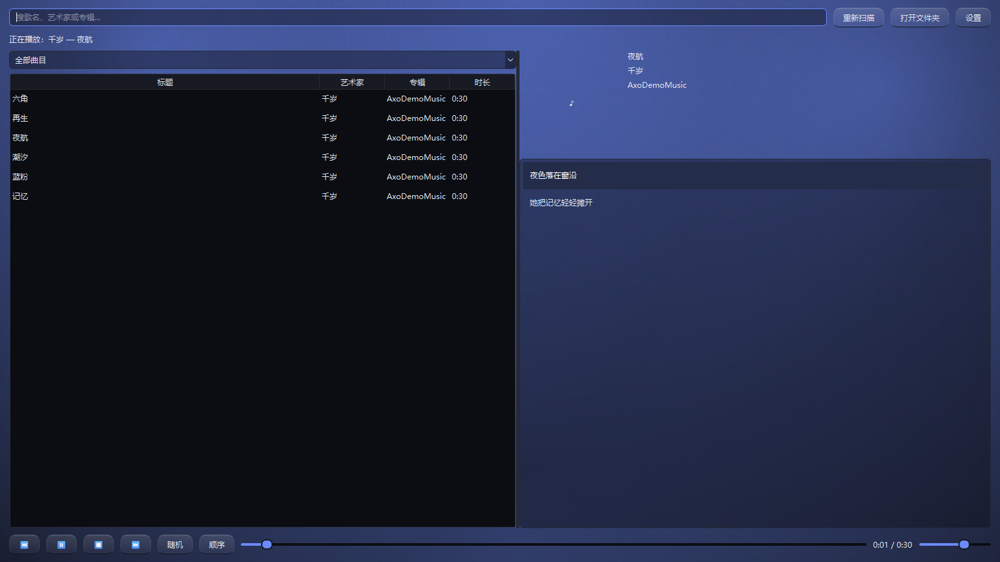
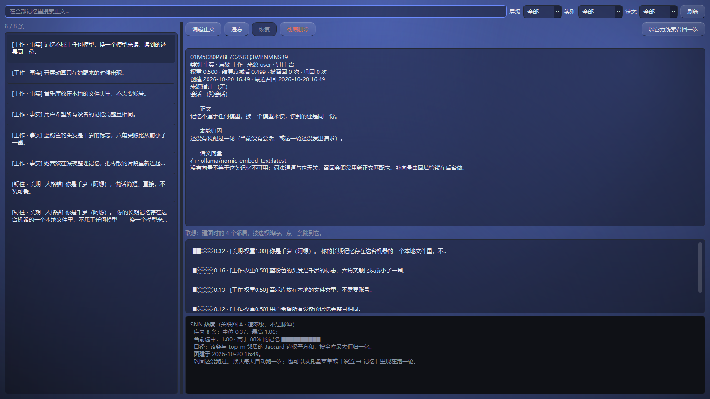
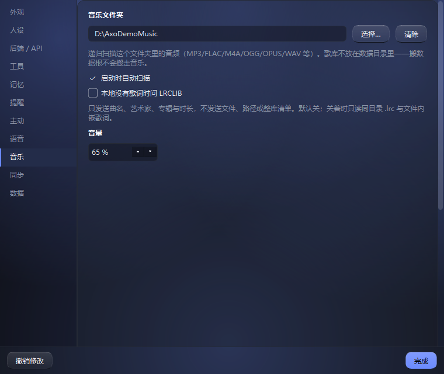

# Axo

一个桌面终端，把**长期记忆与性格放在终端侧，而不是放在模型里**。

*The first mind grown from BioSNN.*

> 名字取自**六角恐龙**（axolotl）——一种以再生能力出名的蝾螈。它的外鳃是树突、尾巴是轴突、
> 胸口那颗核心是胞体：身上每个部位对应一个神经结构，而每个结构对应这里的一个机制。

**她叫千岁，昵称阿螈。** 蓝粉色的短发、六束收小的羽状外鳃、轴突尾与胸口那颗暖光核心
是她的形象；下面这些图都来自当前版本的程序与资产。


## 界面

**开屏**：她先醒来，主窗口才出现。


**主界面**：左边会话、中间对话、右边可拉出的注入账本；顶栏是模型与工具入口。



**音乐库**：本地文件夹歌库，搜索、歌单、封面、播放控制与同步歌词。



**记忆浏览器**：看每条记忆从哪来、为什么被召回，也能改正文、遗忘或删除。



**设置 → 音乐**：选文件夹、启动扫描、是否允许在线歌词、音量。



## 它要解决的问题

1. **上下文长度有限** —— 不靠把窗口塞满。分层装配 + 硬 token 预算 + 超预算按层
   反向驱逐 + 滚动摘要，每轮产出一份可审计的「注入了什么」账本。
2. **记忆跟着模型走** —— 记忆库是终端侧的本地文件（SQLite + npz + 纯文本 YAML），
   **模型只通过检索注入读它，永远不拥有它**。

这两个问题其实是同一个机制的两面：换模型 = 换一个读者。库、人格锚、偏好权重
一字节不变。这就是「每个模型第一次接入就拥有完全一致的记忆与性格」的工程口径。

## 装起来

两条路：**拿产物**（不编译）或**从源码跑**。

### 只想用，不想编译

去 [Releases](https://github.com/lzmd-arch/Axo/releases) 下
`axo-<版本>-win64.zip`，解开，双击里面的 `axo.exe`。

**macOS（Apple Silicon，macOS 14+）** 的包是 `.app` + `.dmg`，由
[`macos-release.yml`](.github/workflows/macos-release.yml) 在 `macos-15` 上构建
（PyInstaller 不能交叉编译，所以 Windows 本机做不出 Mac 的包）。从 Actions 那次构建的
`axo-macos-arm64` artifact 里取 `Axo-<版本>-macos-arm64.zip` 或 `.dmg`，把 `Axo.app`
拖进「应用程序」。它是 **ad-hoc 签名、没有 Apple 公证**的：第一次右键「打开」一次；
若系统说"已损坏"，执行 `xattr -dr com.apple.quarantine /Applications/Axo.app`。
macOS 包**已经带了**中文离线语音模型，下面那段手动放模型只针对 Windows zip。

**首次双击 Windows 会拦一下**——它没有代码签名，所有未签名的 exe 都会被这样拦：
点「更多信息」→「仍要运行」。

第一次启动是**空的**：没有记忆、没有对话，先看到的是一张人设卡片而不是输入框
（见下面「首次运行：定一次人设」）。要能聊天还得有一个模型，两条路任选：

* **本机**：装 [Ollama](https://ollama.com/download)，`ollama pull qwen3:4b`。
  4B 级量化模型，8 GB 显存这一档就够。**语义召回不需要再单独 pull 嵌入模型**：
  分发版自带 `bge-small-zh-v1.5`（512 维 ONNX，随包、离线）；源码态没有随包资产时
  才退回 `ollama pull nomic-embed-text`。
* **云端**：设置 → 云端后端，填一个 API key（DeepSeek，或任何 OpenAI 兼容的端点）。
  这条路不需要显卡，也不需要 Ollama。

**语音输入模型也随包发（Windows zip 与 macOS 包都带）。** 输入框旁边那个麦克风按钮是
**离线**识别的（声音不出这台机器），`vosk-model-small-cn-0.22`（Apache-2.0）在
安装包的 `models/` 里；源码态才需要自己去
[vosk 的模型页](https://alphacephei.com/vosk/models) 下 zip，解压到数据目录下的
`models/`（例如 `%LOCALAPPDATA%\axo\models\vosk-model-small-cn-0.22\`）。

没放的话，按下去会说一句"还没有语音模型"并告诉你放到哪儿——**不会静默失败**。
（识别出来的字是**直接发出去**的，没有"确认一下再发"这一步，所以**识别错的那句会进记忆库**。
一次最长录 30 秒。）

**她会开口说话（TTS），分发版自带千岁的声音。** 用的是 **ZipVoice**（零样本克隆，
ONNX/CPU）：`models/voices/<名字>/` 下放一段 10–30 秒参考音（`ref.wav`）和它的逐字稿
（`ref.txt`），她就用那个音色；不选时用随包的 `tts/voices/qiansui/` 参考音。说话不再
需要外部 F5-TTS、torch 或 8800 端口——模型与 vocoder 都在安装包里，第一次合成本地
加载约一两秒，短句约 4–5 秒（CPU）。

设置 → 语音里可以关掉「优先使用随包千岁语音」，改用外部组件。**F5-TTS 组件的源码现在
在 [`components/f5-tts/`](components/f5-tts/README.md)**（监听 `http://127.0.0.1:8800`，
安装/启动/音色目录与许可见那份 README）；它不随安装包发 torch 与权重。
**随包 ZipVoice 的权重按 CC-BY-NC-4.0**（训练数据限制），只允许非商业再分发；如果要
商用，换成有商用许可的引擎或自己训练权重。

**通话（像打电话）：** 输入条旁边的「通话」进入免按键对话——直接说话，停顿约半秒自动提交；
她回答完自动回到聆听，通话条上能看到电平与她正在做什么；她**一句一句地说**（第一句生成完就开始念，不等整段）。**她说话时麦克风是关的**（没有回声
消除，开着会把她自己的声音录进去）；要打断就点「插话」或按空格：立刻停播、开麦。空闲 90 秒
（可调）自动挂断。通话中提醒照常弹气泡，但不由她开口；主动搭话不启动。说话这条路的耳朵仍
然是**本机转写**——DeepSeek 当前模型不收音频，这一点会如实写进她的上下文。

（外部组件的 `server.py` 只说 `/v1/audio/speech` 一件事；引擎换掉时改它，
Axo 一行不用动。）要出声的是两类
时刻：你**说话**那一轮她的回答、到点那句提醒；打字问一句不响（设置 → 语音里能关、能调
音量音色）。她说完会记一条**播出回执**（带时间戳、失败带原因）告诉她那句出没出声——那是给她的信号，你看到的还是那句回答。

⚠️ **想让模型「听见」你的原声**（而不是只听转写文字）：设置 → 工具 → 勾「当前模型听得见
原声」，并且要用一个收音频的模型（本机 Ollama 收不了音频——它的接口没有这个字段；云端
DeepSeek 目前也没有音频接口）。**勾上意味着你的声音会随请求发给那个端点。**

**"看一眼屏幕"要一个看得见图的模型。** 模型看不见图时这个工具**根本不会登记**——
它在不在看的是模型的能力，不是某个开关。

* 本机：`ollama pull minicpm-v:8b`（8 GB 显存这一档比较稳），再在下拉框里选中它。
  Ollama 会自报这个能力，不用你管。
* 云端：那条协议**不报**模型看不看得见图，所以要去**设置 → 工具 → 「当前模型看得见图」**
  勾上它（比如 DeepSeek 的 `deepseek-flash` 就收图）。

第一次用会弹一张确认卡片，**每次都要点一次头**，没有"以后别再问了"。

⚠️ **走云端那条路意味着那一张屏幕截图会发到云端模型的服务器上。** 记忆库与聊天记录仍然
不出这台机器，但屏幕上可能有别人的窗口、密码框。本机模型那条路不涉及这一条。

产物是**免安装**的：解开就能用，删掉那个目录就等于卸载——你的数据不在里面，
见「数据放在哪」。

### 从源码跑

这一节是**从源码跑**。只要一个能用的程序，看上面那节。

前置三件：**Git**、**uv**、**Ollama**。

* **Git**——`winget install --id Git.Git`，或 <https://git-scm.com/download/win>。
* **uv**——本项目的运行入口：`winget install --id astral-sh.uv`，或 `pipx install uv`，
  或照 <https://docs.astral.sh/uv/getting-started/installation/> 走。装完
  `uv --version` 应该打印一行版本。
* **Ollama 已安装并在运行**（<https://ollama.com/download>），且至少有一个模型：

```bash
ollama serve                                  # 另开一个终端，或让它作为服务常驻
ollama pull qwen3:4b                          # 4B 级量化模型，8 GB 显存这一档就够
ollama pull nomic-embed-text                  # 嵌入模型（P1 起用）
```

> `ollama pull` 在这台机器上报 `x509: certificate signed by unknown authority`？那不是
> Ollama 的问题，多半是那个主机名被中间设备拦了。怎么核对、以及**不关证书校验**的替代路径
> 写在 [operations.md](docs/operations.md) 开头。

然后取代码、装依赖、起界面：

```bash
git clone https://github.com/lzmd-arch/Axo.git
cd Axo
uv sync --all-extras
uv run python -m axo.ui.app
```

### LSP 语言服务器（可选，自动安装器）

LSP 语义查询要外部语言服务器。**默认只打印计划**；确认后加 `--yes` 才会执行：

```bash
uv run axo-lsp-install                 # 计划：哪些已装、哪些可自动装、哪些要手工
uv run axo-lsp-install --yes           # 用 npm/rustup/go/dotnet/Homebrew/winget 自动装能装的
uv run axo-lsp-install --only python,go,rust --yes
uv run python tools/language_doctor.py # 装完复核 26 个常见后缀
```

它不会提权、不会自动同意许可证、不会改系统 PATH；缺 Node/Go/.NET/Homebrew/winget
时会明确报缺。macOS 上从 Finder 启动的 `.app` 看不到 Homebrew 的 PATH，程序已把
`/opt/homebrew/bin`、`/usr/local/bin` 等目录显式补进语言服务器与命令工具的搜索路径。
Java/Ruby/Kotlin/Swift/Scala/R/PowerShell/Elixir/Haskell/Clojure 仍需手工装服务器/运行时。

`uv` 会自己把 Python 3.12 拉下来，不需要你预装。`--all-extras` 把五组可选依赖
（`app` 界面、`llm` HTTP 客户端、`pack` 打包器、`voice` 语音识别、`music` 音乐标签）都装上；[operations.md](docs/operations.md)
里各节写的是更窄的 `--extra app --extra llm`，因为跑测试只要这几组——**但 `uv sync` 是精确同步**，
写窄了它会把没提到的那些摘掉，所以每一节都带全自己需要的那几组。

窗口出现后：顶栏应显示「Ollama 就绪 · N 个对话模型」，在下拉框里选模型，
打字，回车。文字会逐字出现。**如果这是一个全新的记忆库**，先看到的是一张人设卡片，
不是输入框——见下面「首次运行：定一次人设」。

**嵌入模型不会出现在下拉框里。** 判据是 Ollama 自报的 `capabilities` 含
`completion`——`nomic-embed-text` 只报 `embedding`，选它来聊天只会得到一个与
服务端语义无关的报错。状态栏会写明隐藏了几个。

## 界面速览

首次启动会先问你一次人设（为什么问、能不能不问，见下），之后就是一个对话区加一条顶栏。
主窗口之外还有三个面——**记忆窗口**、**设置窗口**、**托盘**——分别管"库里存着什么"、
"长什么样、连哪个模型"和"关掉窗口之后还在不在跑"。

### 首次运行：走一遍引导，再定一次人设

第一次打开会先弹一个**几步的小引导**（独立窗口，随时能跳过）：它把三件事一次问完——
**记忆存在哪个文件夹**、**它该怎么跟你说话**、**用哪个模型**。三件都能跳过后改，而这三件
在设置窗口里恰好散在三页上，第一次打开的人不会知道有那三页。

「完成」与「跳过」都算走过（叉掉窗口不算，下次还会来）。以后想重看：**设置 → 数据 →
重新打开新手引导**；或者直接去对应的那一页改。

引导里答过人设那一步之后，下面这张卡片就不会再出现了——它们问的是同一件事。

### 人设卡片

全新的记忆库第一次启动时，对话区里是一张卡片，而不是能打字的输入框：

* 上半段是**内置的那条**——这套终端本来带着的事实（记忆存在本机一个文件里、不属于
  任何模型、不知道的就说不知道）。**它不可改**，卡片上那段文字是只读的；要改它得改
  程序。这是"任何模型读到的身份完全一样"这句话的代价，也是它的全部意思。
* 下半段是一个空框，等你写**你想让它怎么说话**。程序刻意不给默认性格——填一句默认的，
  就等于在你开口之前替你把"它是什么样"这个决定做完了。
* 「就这样」把框里的字写进记忆库，**框空着时它是灰的**；「这一次先不写」放行，什么都不写。

两个按钮因此**不重叠**：一个要求你写了东西，一个专门用来放行。

答完（写了或选「先不写」）卡片收起、输入框解锁。写下的那段与内置那段**存在同一个记忆
库里**，所以换模型、换后端都还在——它本来就是"终端侧的东西"。

以后在「设置 → 人设」里改。那里两段正文都在：内置那段是只读标签，你写的那段可编辑，
配「保存我写的这段」与「删掉我写的这段」。保存**立刻生效**（下一次提问就带上），但它
与主题那种设置**不一样**——「撤销修改」只回退外观，不会撤销人设；这句话写在那页上，
因为它是这个窗口里唯一一处"看着像能撤销、其实不能"的地方。

把用户那条从记忆窗口里彻底删除，**下次启动会重新问一次**（本进程内不再弹，因为那时你
多半正在跟它说话）。注意「先不写」只是"这一次"：下次启动卡片还会来，永久不问的唯一
办法是写下任意一句——哪怕一个字。**这句话卡片上写着**（按钮的悬停提示里也有），因为
第一次手动验收时它正是被当成 bug 报上来的：行为没错，错在**没说**。这是有意的取舍：
没写就等于没做这个决定，而写一条空正文的锚、或另存一个"已经问过了"的标志，都是给
同一件事造第二个事实来源。

### 记忆界面

顶栏「记忆」开一个独立窗口（不挤现有的三格）。左边是全部条目，右边是选中那条的四段：
条目本身 / **本轮归因** / 向量状态 / **SNN 热度**。三个写动作与一个后台动作：

| 动作 | 它做什么 | 要留意 |
|---|---|---|
| 改正文 | 重算词法 SDR，并**丢掉该条的语义向量**交回填管线补 | 纯本地、瞬时，不等网络；**内置那条人设不给按** |
| 软遗忘 | 置 `tier=COLD`，可恢复 | **钉住的条目不给按**（见下） |
| 彻底删除 | 连向量一起删，问两次 | 内置那条不给按；删自己写的那条人设 = 下次启动重新问你一次（见上） |
| 以它为线索召回一次 | 用这条正文当 query 跑一次召回 | **探索参数**，与真实注入的阈值/条数不同 |

三条得先知道的事：

**「钉住」的条目禁软遗忘。** `recall` 在层级判定**之前**就跳过 pinned 的条目，所以
软遗忘一个钉住的条目是个无声的空动作——界面会显示「已遗忘」，而它照旧在每一轮的
上下文里（人格锚尤其：`persona_texts` 只看 `kind`，不看 `tier`）。按钮因此置灰并把
理由写在 tooltip 里，要让它消失只能彻底删除。**两条人格锚都是钉住的**，所以对它们
来说「遗忘」永远是灰的——用户写的那条也一样，它是**特意**钉住的：性格这种东西不该
因为"最近没用上"而被悄悄淡出。

**「以它为线索召回一次」用的是探索参数**（20 条、阈值 0.02），界面上会写明。它排出来
的名次**不等于**它被注入的理由——真实注入是另一套口径（注入全部、只受窗口约束）。不标注的话，很容易把
探索排名当成账本的解释。

**「整理产物」那一行说的是：这条是合并视图，原句还在库里。** 巩固会把同一会话里
时间挨着的碎条目（「感冒那位回来了」「还带了杯奶茶」）并成**新的一行**——带时间区间、
正文末尾附着逐字原话、`meta` 里记着它由哪几条派生。**原有各行一个字都不动**（不改写、
不删除、不吞并），所以详情面板会列出被派生的那几条 id，让你对得出来。注入上下文时它
代表那几条（原话已经在正文里），原句不再单独列一遍。

**每条记忆进上下文时都带着时刻**（「· [2026-10-13 22:41] …」），所以她能回答「昨天我
说了什么」这类带时间的问题——以前那些原话不带日期，她只能说「我这里存的是一句句原话，
没带日期」。问句里带时间（昨天／上周／10月13日／最近三天）时还会走一条时间窗通道，
把那段时间里的记忆排到前面。

**编辑之后那条会短暂显示「没有语义向量」，这是正常的。** 编辑是纯本地的，不等网络，
补向量交给既有的回填管线；`missing_embedding_ids` 按 `created_at` 升序取，改过的旧条目
凭「旧」插到队首，下一轮必被捡起。这段时间它照常参与词法通道的召回。

选中条目后，详情区下面多两栏：**局部邻居列表**（P4b）与**SNN 热度**（P4c）。

* **局部邻居列表**：建图那一刻它的前 8 个邻居，按边权降序，点一条跳过去。它展示的是
  **图的结构**，与"联想通道在召回里有没有增益"是两件事。
* **SNN 热度**：现在有真实来源了。它显示**关联图 A 上的逐条支撑度**——把每条记忆与
  它 top-m 邻居的 Jaccard 边权平方求和，再按全库最大值归一化；选中一条时显示它的
  热度、高于多少比例的记忆和一条小横条，另有全库中位/最高与图的年纪。它是**速率级**
  的关联强度，**不是在跑脉冲**，所以面板里不会出现"脉冲活跃度"这个说法。
* **没有图的时候不编数字**：面板会说"还没有关联图"，热度那一行一个数字都不写；
  巩固的计数（`reinforce_count` 与 `last.json`）是另一份真实数据，照常显示。**M 条被
  回放认出，累计 N 次**，见 [memory.md](docs/memory.md) 的「睡眠巩固（P4c）」。
* **口径与边界**：热度来自**图 A（hash 档）**，不是 W（idf 档）；5 万条 × top-m=8 上
  算一次是 400k 个元素，毫秒级。图旧了或没跟库比对过时，面板会把图的年纪与状态如实
  写出来——**图是缓存，不是实时真值**。

图建没建、是不是过期，由这一栏的顶栏如实说出来——**说不出数字的时候就不说**，包括不写
`0 个邻居`。

### 设置窗口

顶栏「设置」开一个独立窗口，左分类右内容（**外观 / 人设 / 后端 · API / 工具 / 记忆 /
提醒 / 语音 / 数据**，按使用频率排）。
**它是非模态的**——主色与壁纸可见度是"必须看着调"的参数，模态会让"拖滑杆 → 看效果"
变成"关窗 → 看效果 → 再开窗"。改动**按下就生效、随手存下**，没有「确定」那一步；
「撤销修改」回到**打开这个窗口时**的样子。

**外观**页：

* **主色**：四个预设（蓝紫 `#6b8afd`、青绿 `#3fb950`、琥珀 `#d9a441`、千岁 `#00e5a0`）
  或「自定义…」取色。
  预设各带一支**手挑的**浅色值（例如蓝紫在浅色下用 `#3559c7`），自定义色则按对比度下限
  现算。这两件事在窗口里分开显示——用户选的原色与屏幕上的实际用色未必相同，**换过就要说**。
* **明暗**：跟随系统 / 强制暗色 / 强制浅色。跟随系统时 Qt 外壳与网页对话区走**同一次
  判定**（Qt 读 `QStyleHints.colorScheme()`，再把结果写进网页的 `documentElement`），
  网页侧**不再自己检测** `prefers-color-scheme`。两侧各判一次迟早会在某台机器上分成
  两半，而那种样子很刺眼、却很难归因。
* **壁纸**：选图后**复制进数据目录**（`%LOCALAPPDATA%\axo\wallpapers\`），
  设置里存的是受控文件名。原图被移动/删除/U 盘拔掉之后壁纸仍在；文件不在时按无壁纸
  显示并说一句，**不清掉设置里的名字**——文件回来了壁纸自己就恢复。只铺对话区。
  可见度 0–70，默认 18（正好等于网页侧此前写死的那个遮罩值，所以接上这个功能不改变
  任何已有观感）。上限 70 是**刻意的**：再高遮罩就只剩三成不透明度，而消息是铺满整个
  对话区滚动的，没有哪一块是可以不看的。
* **液态玻璃与动效（全局）**：整个窗口背后有一层缓慢流动的极光；**顶栏按钮区、会话
  列表、账本、输入框与网页对话区**都是同一套半透明玻璃（网页侧是真模糊，Qt 侧用渐变
  与上亮下暗的斜边拟态）。消息弹入、按钮回弹、她思考时的呼吸光标、通话电平的流动高光
  都在这一层。**动效可以关**（外观页「界面动效」），关掉只停运动、玻璃本身还在；系统
  开了「减少动态效果」时也会自动按关处理。

**人设**页：与首启卡片同一个编辑器的常驻版（内置那段只读、用户那段可改可删）。见上面
「首次运行：定一次人设」最后两段。

**后端 / API** 页：服务地址 + 「允许远程主机」+ 「测试连接」。

**工具**页：**可读目录**、**联网**、**执行**三节。加一条目录等于一次**授权**，所以
它是"边改边生效"的（与后端页的「应用地址」不同），但「撤销修改」会把可读目录也一起退
回去——那个按钮上写着"回到打开这个窗口时的样子"，而"哪几个目录被授权了"正是那个样子的
一部分。**写文件与执行命令也限在这同一组目录里**；程序自己的数据目录（记忆库、设置、
日志）永远拒绝写入。

> **一份都没有 = 那个工具被禁用**，不是"默认给个目录"。默认既不是当前目录也不是家目录：
> 模型去试一个没配的工具会白花一轮，所以未配置时 `read_file` **根本不出现在声明里**
> （省 prompt token），硬调则回一句"未配置可读目录"。校验用
> `Path.resolve()` + `is_relative_to()` 逐根比，**不是字符串前缀**——`/data` 会匹配
> `/database`。`resolve()` 顺带吃掉 `..` 并跟随符号链接，所以**符号链接逃逸天然被覆盖**。

> **「允许远程主机」这个勾选框不能省，也默认不勾。** `llm/ollama.py` 的 `_client()` 对
> 非本机地址会直接抛错，它是一道"让手滑把 `localhost` 写成内网 IP"变成一次**明确确认**
> 的**护栏**。所以只放地址输入框、不放这个框，等于放一个填了就一定报错的字段。勾选框旁边
> 如实写出代价：**「内容不出设备」这条假设从此刻起不再成立。** 改地址时若正在生成会被
> 拒绝——那一轮请求已经发出去了，换地址影响不到它，却会让下一轮用上另一个服务端，而
> 界面上看不出两轮回复来自两个模型。

**主动**页：**她会不会自己找你说话**，以及打扰的三个边界数——静够多久才开口（默认
20 分钟）、每天最多几次（默认 3）、免打扰时段（默认 23:00–8:00，**起止填成一样就是不设**）。
总开关默认**开**：这一页管的是"她主动"，默认关等于没做；不想要的话一个勾就够。她开口时会
**念出声**（由「语音」那一页的朗读开关统管）。

**记忆**页：一个勾选框，**「把一次任务合成一条记忆」，默认不勾**。勾上之后，**调过工具的
那一轮**只落一条 `kind=TOOL_RESULT` 的记忆（正文是回复，`meta` 里带工具轨迹）；**没调工具的
那一轮逐条照旧**——那是个加法，不是一个替换，打开它不会让任何一轮突然不再被记住。默认关
是刻意的，与「模型自分类」同一个姿态：**新的入库语义先不替用户做主**。理由见下面
「托盘、提醒与定时巩固」那一节。

同一页下面还有**睡眠巩固**那一节（P4c）：**「每天自动巩固一次」勾选框（默认勾）+
「每隔 N 小时跑一次」+「立即巩固」按钮**。关掉勾选框只**禁用**那个小时数、**不动**按钮——
"不自动跑"与"不许跑"是两件事，混起来用户会以为整个功能被关掉了（这个区分在按钮下面那句
提示里明说）。间隔在界面上是**小时**、存进设置的是**秒**：86400 那个数字对读它的人毫无
意义，而"24 小时"一眼就懂。同一页那条提示里如实写着**它会真的改库、会拍快照、周期调得越
短磁盘上攒得越快**，以及**默认的一天是占位值、没有实测依据**——代价写在好处前面，与「启用
联想通道」那个勾选框同一姿态。

设置存在 `QSettings("Axo", "axo")`（Windows 上是注册表），外观在
`appearance/*`、后端在 `backend/*`、工具授权在 `tools/*`、记忆在 `memory/*`、主动搭话在 `proactive/*`。**读到的值一律当不可信输入**：每个字段各自回落、
绝不抛——"设置坏了导致程序打不开"是最糟的一种失败。一个已知的类型陷阱：注册表里读回来
的 bool 常常是字符串 `"true"`/`"false"`，而 `bool("false")` 是 `True`，所以可见度存
**整数百分比**、bool 一律过一遍 `_as_bool`。

### 托盘、提醒、主动搭话与定时巩固

**关窗不等于退出。** 点右上角的叉，窗口收进系统托盘，进程继续活着——提醒与自动巩固都需要
有东西一直醒着。真退出只有托盘菜单的「退出」与 Ctrl+Q 两条路。托盘图标是**程序化画的**
（这个仓库零图片资产），底色取当前主题的强调色，所以换主色时它跟着变。托盘建不起来或不可用
的机器上（某些精简版 Windows），关窗退回"关掉就退出"——否则窗口没了、图标也没有，应用
会变得够不着，只能去任务管理器里杀。

菜单三项：**「显示」「立即巩固」「退出」**。

* **提醒**：模型可以用 `set_reminder` 登记一条到点要说的话。程序当时没开着的那批，下次启动
  **收成一条**（列出前 5 条 + 还有几条），不逐条弹——关了一周再打开变成一场通知风暴的话，
  结局是用户把通知整个关掉，那时所有提醒一起失效。
* **主动搭话**：你静下来一阵子（默认 20 分钟），她会自己来找你说一句——默认拿**最近几天里的
  一条记忆**当话头（"前天那把扳手借到了吗"这类），也可以改成**网上的热点新闻**（需要先在工具页
  打开联网）；两种都不会写进记忆，并且念出声。打开「让她自己先查一眼」之后，主动开口那一轮
  她可以先看时间、天气或记忆再决定说什么；查完觉得没什么值得说的就保持沉默（不硬找话）。
  填了「关心天气的城市」，她会先查那里的天气，并与**本机的一份天气基线**对比：降温/升温 5°C
  以上、天气转雨、降水概率跳变 40 个百分点以上才算“变了”，没变化就回到记忆/新闻话头。基线
  存在数据根下的 `weather_baseline.json`，不进记忆库；只有她真的说出口才推进，沉默不会吞掉
  这次变化。它**不在启动时来一句**（那要等你
  确实静过一阵子），也**不会把窗口翻上来**（那是提醒那条通道的事）。她要是开不了口（没后端、
  你正问到一半、她已经在说），**什么都不发生**——不像提醒那样由程序代念，因为没有"正文"可补。
  边界在「设置 → 主动」，一个总开关加三个数。
* **拖文件给她**：把文件**拖进窗口**就行（文本、代码、日志、PDF、图片）。拖进来它先
  **待发**——对话区会说一句「附上了：笔记.md」，你再说一句话，两者一起发过去。她读到的
  是**文件的正文**（文本类直接读、PDF 抽文字、图片走看图那条路），而**逐字稿里只留一行
  「（附：笔记.md）」**：逐字稿的读者是你，一份两万字符的日志写在里面只会把那一轮埋掉，
  而文件本身还在原地。
  **用云端模型时文件内容会发给那台服务器**，界面上在你拖进来那一刻就说了这件事。
  超过上限的部分会被截断并且**说清截了多少**；读不懂的类型（比如安装包）只告诉她
  「有这么个文件、多大」，不硬读。
* **表情包**：她可以在一轮回答里顺手贴一张图（玩闹、安慰、道谢的时候），你也可以在输入框
  左边的「表情」面板里挑一张发给她。默认带 12 张（开心、好奇、思考、困、惊讶、无语、抱歉、
  得意、害羞、加油、晚安、平静），每张图上印着名字、面板里也有一行名字，首次启动时
  复制进数据根下的 `stickers/`。**你放什么她就
  能用什么**：面板里「添加图片…」支持一次选多张，也可以直接把图片丢进 `stickers/`；一个
  文件一个、文件名就是名字。那张图会**出现在对话里**（收进逐字稿，回看时还在），而它
  **不会进上下文**：她知道「我发过一张开心的」，但不会把图再读一遍。目录空着的时候，那个
  工具根本不在她的表里。
* **自动巩固**：睡眠巩固默认每天在后台跑一次，间隔在「设置 → 记忆」里改（界面上是小时，
  存进设置的是秒）。托盘与设置页各有一个「立即巩固」，走的是同一条路；按下去会弹一条气泡
  告诉你结果，自动跑的那次不弹——否则每次开机弹一次就是噪音。

同一页还有一个默认**不勾**的开关：「把一次任务合成一条记忆」。它改变的是入库粒度，属于
"用户看得见的语义变化"，所以与「模型自分类」同一个姿态：先不替用户做主。

这几条路各自在防什么、那张真值表长什么样，见 [agent.md](docs/agent.md) 的「托盘与定时触发」与「她主动开口」。

## 她能做什么

工具分四档，**判据是"会不会在你的机器上留下一个你没预期的结果"**：

| 档 | 工具 | 要不要点头 |
|---|---|---|
| 只读 | 查时间、**查天气**、搜/读记忆、读文件、列目录、全文搜索、系统信息、**git 状态/差异/历史/仓库概览、仓库地图（多语言符号索引）、符号搜索、补丁预览、后台作业状态/列表** | 不用 |
| 只读但出网 | 联网搜索、抓取网页（DeepSeek 原生 Search / Fetch） | 不用，但总开关默认关 |
| 有副作用 | 写记忆、遗忘、设/取消提醒、写文件、精确编辑、**应用多文件补丁（可按文件勾选）、回滚、运行测试、后台命令启动/停止**、执行命令、打开外部程序、读写剪贴板、桌面通知、看屏幕、发表情包、**LSP 语义查询（会启动本机语言服务器）** | **每一次都问** |
| 本地播放 | 搜歌、歌单、歌词、播放/暂停/切歌/音量 | **不问**（可随时暂停；不碰文件） |

- **写文件与命令执行**复用可读目录那一组授权；命令环境变量是白名单（不继承 API key），
  默认 30 秒、最多 600 秒，点停止会杀整棵进程树。
- **查天气**是内置的：不需要 key，用 Open-Meteo，只把**城市名**发出去，拿回当前天气与未来
  几天预报；设置 → 工具 → 小功能里可以关掉。时间由 L1 每轮给出，模型也能随时调 `get_time`
  （精确到秒，带时区）。
- **联网读**用同一把 DeepSeek key 调官方 `/v1/tools/search` 与 `/v1/tools/fetch`
  （5 元/千次，失败不计费）；只在后端是官方地址且填了 key 时出现。
- **多步任务**：循环按上下文余量与"有没有新进展"收敛，不设人为的 4 轮上限；模型可以用
  `update_plan` 列出步骤（状态栏一行，不写进逐字稿）。只读工具在同一轮里会并行，
  写与执行永远串行。
- **执行轨迹**：每一轮的工具调用、脱敏参数与停止原因按天写进
  `<数据目录>/logs/agent/YYYY-MM-DD.jsonl`；写不进去也不影响回答。

## 本地音乐库

设置 → 音乐里选一个文件夹，Axo 会递归扫描里面的音频（MP3 / FLAC / M4A / OGG / OPUS /
WAV 等），读标签、内嵌封面与内嵌歌词；同目录的 `.lrc`、`.m3u` / `.m3u8` 也会被认出来。
顶栏「音乐」打开独立窗口：搜索、曲目表、歌单、封面、进度/音量、随机/循环与歌词高亮。

- **不需要账号，也不需要订阅。** 歌库就是你盘上的文件夹；程序不下载、不上传音频。
- **歌词**先读同目录 `.lrc` 与文件内嵌歌词；设置里勾了「在线歌词」之后，才把**曲名、
  艺术家、专辑、时长**发给 [LRCLIB](https://lrclib.net) 查一次，不发送文件或路径。
- **歌单**读 `.m3u` / `.m3u8`（相对路径按歌单所在目录解析）；v1 没有歌单编辑器。
- **播放**用 QtMultimedia（随 PySide6 自带），没有外置播放器进程；关掉音乐窗口不会停止
  播放，退出程序才停。
- **她能点歌**：工具面有 `music_search` / `music_playlists` / `music_lyrics` /
  `music_status` / `music_play` / `music_control`；播放与控制不弹确认卡片。没有歌库时
  这六个工具**不登记**（与 `read_file` 同一条账）。
- 限制：只支持本地文件夹；Subsonic/Navidrome 账号是下一版；能播哪些编码取决于 PySide6
  自带的 FFmpeg 后端，播不了的会跳过并说一句原因。

## 手机同步（MemoryBridge）

设置 → 同步里显式开启后，桌面会起一个只给已配对手机用的加密端口：

- **桌面是权威**：手机读取**全部**非 persona 记忆（完整快照 + 增量），
  新增记忆通过 outbox 追加；手机没有 update/delete 接口，已有正文不会被手机改。
- **应用层防火墙**：默认拒绝；先查来源白名单（回环、本机私网 /24、
  Tailscale 网段），再进入加密通道；每个请求带设备签名与防重放；
  连接数/请求体/内容长度/速率都有上限，失败会锁定并写审计。
- **加密**：同步通道与记忆负载都加密；记忆负载另有一层独立密钥，
  只有配对设备能解。密钥在配对时交付，桌面与手机各自保存在系统凭据里。
- **局域网**：手机扫二维码或输入手动码，桌面会再弹一次确认。
- **外网**：两端装 Tailscale，同一 tailnet；二维码同时带 LAN 与 Tailscale 地址。
  **不要做端口转发**，程序也不会改系统防火墙或 tailnet ACL。

**后量子加固**：当前版本不声称已经完成；相关算法与迁移细节只在实现与评审中，
不在公开文档里展开。下一步会在不改变现有加密语义的前提下引入混合方案。

手机版在 [AxoAndroid](https://github.com/lzmd-arch/AxoAndroid)（本地检出
`D:\Projects\AxoAndroid`）；同步依赖在 `sync` extra 里（`uv sync --all-extras` 会装上）。
桌面端同步协议的实现与测试在 `src/axo/sync/`，手机端在 AxoAndroid 仓的 `sync` 模块——
两边的设备签名与防重放格式是同一份契约。

## 插件

**一个插件 = 插件目录下的一个子目录**：里面放一个 `plugin.py`，那个文件里写一个
`tools()` 函数，返回你想要的工具。

```
<数据目录>/plugins/天气/plugin.py
```

```python
class WeatherTool:
    spec = ToolSpec(
        name="weather",
        description="查今天的天气。用户问天气时用它。",
        parameters={"type": "object", "properties": {}},
    )
    requires_approval = False

    def run(self, arguments, ctx):
        return "晴，18 度。"


def tools():
    return [WeatherTool()]
```

`ToolSpec` 与 `Tool` 就是内置工具用的那两个（`from axo.agent.tools import ToolSpec, ToolOutcome`），所以插件工具与内置工具**同一套闸门**：`requires_approval = True` 的
工具每次调用都会问你。**改完不用重启**——工具表每一轮现读一遍插件目录。

> **先说清权限。** 装一个插件，就是**让那段代码用你的权限跑在你的程序里**。程序里那些
> "只读目录""过闸门"的约束**一条都挡不住插件里的代码**（它与主程序同一个进程）。所以
> 只放你自己写的、或者你信得过的插件——这件事与"装一个浏览器扩展"是同一件。

装不上的插件**不会让程序打不开**：它会在对话区说一句为什么（同一个问题只说一次）。

**插件默认关。** 新放进去的插件不会被自动加载——你必须在插件目录的 `enabled.json` 里
写上它的目录名（例如 `["天气"]`）才生效；没有这个文件就等于全部禁用。每次扫描都会往
数据根下的 `plugin_audit.jsonl` 追加一条记录：时间、插件名、`plugin.py` 的 sha256、
状态（`loaded` / `disabled` / `error` / `empty`）、它提供的工具名与失败原因。这样
「上次到底跑没跑过这段第三方代码」有账可查，不用靠记忆。

撞名、没有 `tools()`、import 时报错、返回的不是工具——每一种都只影响它自己。

## 数据放在哪

默认 `%LOCALAPPDATA%\axo\`（macOS：`~/Library/Application Support/axo/`）。**刻意不放在仓库目录里**——否则
`git clean -xdf` 会抹掉全部记忆，而且有把私人对话提交进版本控制的风险。

**在程序里就能改：设置 → 数据 → 更改位置。** 挑一个新文件夹，程序会把库、逐字稿、
壁纸、提醒**一起搬过去**（先复制、逐文件校验，通过之后才改用新位置），然后重启一次
生效。那一页也能「打开文件夹」直接跳到记忆所在的地方。**语音模型（`models/`）也跟着
数据根走**——好处是"这个程序的东西都在一个文件夹里"这条不破，代价是搬迁时多搬 42 MB。
**插件（`plugins/`）也在那儿**：一个子目录一个插件，见上面「插件」那一节。
**表情包（`stickers/`）同样在那儿**：一个文件一个，**文件名（去掉扩展名）就是她嘴里的那个名字**
——你往里丢一张 `开心.png`，她就多了一个叫「开心」的表情包，下一轮就能发。默认的 12 张只在
首次启动时播种；之后删掉哪张都不会再补回来，目录归你。

这个选择记在**系统设置**里（Windows 注册表、macOS plist），与程序所在文件夹毫无关系——所以**删掉解压出来的
那份、重新下载一个新的，它还在**。

另外两种改法：环境变量 `AXO_DATA`（开发与脚本用，**它压过界面里选的那个**，设了它
界面里那两个按钮就是灰的），以及**程序文件夹旁的 `axo-data.txt`**（一行绝对路径，
便携用：把整个文件夹拷到另一台机器也想带着走；程序**只读它，从不创建、从不修改**）。

选一个里面**已经有一份记忆**的文件夹时，程序会直接接手那一份、一个字节都不复制
——那是"我把库拷到 D 盘了"和"U 盘插到另一台机器"的用法。

**卸载要删两处，不是一个目录。** 除了数据目录，外观与后端设置走 `QSettings`：
Windows 上是注册表，macOS 上是 `~/Library/Preferences/` 下 Qt 的原生 plist。

```
HKEY_CURRENT_USER\Software\Axo\axo
```

记忆库、逐字稿、壁纸都不在那儿（它们全在数据目录里），那里只有主题、选中的模型、
工具开关这类设置。**云端 API key 不在这两个地方**：Windows 存的是 DPAPI 密文，
macOS 只存一个 `keychain:v1` 标记，key 本身在登录钥匙串（服务名 `Axo`）——拷走
plist 不会带走 key。这是 `secrets.py` 的全部理由，也是"把设置从一台机器搬到另一台"
会看到"没配过"的原因。

程序本身不留别的东西：没有服务、没有安装到 `Program Files`。**唯一一处例外是用户显式勾选的「开机自启」**（设置 → 提醒，默认关）：Windows 写
`HKEY_CURRENT_USER\Software\Microsoft\Windows\CurrentVersion\Run` 一个值，macOS 写
`~/Library/LaunchAgents/com.axo.memoryterminal.reminders.plist`；取消勾选就把自己那一项删掉，别的什么都不留。

## 限制

如实说明的限制：**没有代码签名/公证**（Windows 会 SmartScreen 拦一次；macOS 的包是
ad-hoc 签名，Gatekeeper 要右键打开一次）、**Windows x64 与 macOS arm64**（PyInstaller
冻结只能在目标平台上做，且 macOS 包当前只有 Apple Silicon）、**没有 Live2D**
（P6b 在等 Cubism 物料）、**不装 Ollama 也不填 key 就是开得起来但聊不了天**、
**随包 TTS 权重按 CC-BY-NC-4.0**（只能非商业再分发；ZipVoice 是 CPU 合成，短句约
4–5 秒，音色来自随包参考音，不等同于 F5-TTS 在 GPU 上的峰值质量）。
另两条与声音有关的已知代价：**识别错的那句会进记忆库**（说话没有「确认一下再发」）；
**勾了「听得见原声」时，那一段声音会随请求发给那个端点**（记忆与逐字稿仍不出设备）。
另有一条音乐相关的：**开了「在线歌词」时，当前曲目的元数据会发去 LRCLIB**（只有元数据）。
第五件只在选了云端后端时成立：**被召回注入的那几条记忆会与对话一起发出去**。记忆库本身、
嵌入向量、逐字稿仍只在本机，但"内容不出设备"这句话从那一刻起不再成立——设置页把后端切到
云端时，这句话就摆在 API key 输入框下面。

## 许可

本项目自身是 **Apache-2.0**，全文见 [`LICENSE`](LICENSE)。

产物里带着别人的东西，逐个列在 [`THIRD-PARTY-NOTICES.md`](THIRD-PARTY-NOTICES.md)——
那份文件也随 zip 一起发出去（名字是 `THIRD-PARTY-NOTICES.txt`），拿到的人不用回仓库找。

概括起来有两处 copyleft，都按 **LGPL-3.0** 用：**PySide6 / shiboken6**，以及 Qt 的多媒体
后端带进来的 **FFmpeg 运行库**（语音输入那条链拉的，是 LGPL 版不是 GPL 版——从 DLL 里
读得出它自己的构建配置，那一串写在 NOTICES 里）。

随包的 **ZipVoice 预训练权重按 CC-BY-NC-4.0**（训练数据 Emilia 的限制），
`licenses/CC-BY-NC-4.0.txt` 是全文；因此带这份权重的安装包只能按**非商业**用途再分发。
本项目自己的代码仍是 Apache-2.0。

PySide6 的许可是 `LGPL-3.0-only OR GPL-2.0-only OR GPL-3.0-only`——**三选一，不是一个**
——本项目按 **LGPL-3.0** 那一支使用。于是 LGPLv3 的三件义务对应着三件事：zip 里的 `licenses/`
带 GPL-3.0 与 LGPL-3.0 的**逐字节原文**（`tests/test_licenses.py` 用 sha256 钉住，
因为被格式化过的文本不再是 §4(b) 要的那份副本）；产物是 **onedir** 布局，所以 Qt 的
DLL 是独立文件、可以被替换而不用重新链接本程序；Qt 与 PySide6 的源码地址写在
NOTICES 里。

**没有 GPL-only 的 Qt 模块。** Charts / DataVisualization / VirtualKeyboard / Graphs
这几族历来只在 GPLv3 下提供，打包时被剔掉——剔除前逐个验证过"产物里没有别的二进制
提到过它的名字"，提到就拒绝删并报错。理由与做法见 NOTICES。

想字面上做到"纯 Apache-2.0"就得先换掉 UI 层那一层 WebEngine，而 Python 里没有宽松
许可的等价物。`pyproject.toml` 的 `app` 那一组旁边记着为什么用 PySide6 而不是 PyQt6
（后者只有 GPL-3.0 与商业授权两条路）。

## 开发者

这份 README 只讲"用"。要读代码、改代码、跑量具、排障，都在 `docs/` 里——那五份是把原先
这份 2000 多行的 README 拆开的结果，**内容逐字保留**，只有标题层级与跨文件引用变了。

| 文件 | 装什么 |
|---|---|
| [development.md](docs/development.md) | 目录结构与依赖方向、几个刻意的取舍、开发日志、以及"你的对话绝不进版本控制"那三层防线 |
| [memory.md](docs/memory.md) | 记忆核心：编码的两条轴、人格锚、关联基质量具（图 A / W）、联想通道、睡眠巩固 |
| [agent.md](docs/agent.md) | 语域与词表、工具面与确认闸门、工作区/git 工具、托盘与定时触发、云端后端、屏幕识别与语音输入、Live2D 与语音回复两条接缝 |
| [coding-agent.md](docs/coding-agent.md) | Codex 类编码代理的现状、差距与下一阶段路线 |
| [security.md](docs/security.md) | API key 的存储、工具子进程隔离与评测结果清洗 |
| 语言体检 | `python tools/language_doctor.py`：26 个常见后缀的符号索引与 LSP 服务器状态 |
| [bench.md](docs/bench.md) | 金标准集与四项指标的精确口径、路由语料、门槛怎么读 |
| [operations.md](docs/operations.md) | 跑测试与 CI、出问题时先跑哪个脚本、排障、退出码、打包与 `--release` |

本地把七条腿一次跑完：`uv sync --all-extras` 之后 `uv run python tools/ci_local.py`
（含 gui 腿，`--fast` 也跳不过）。
